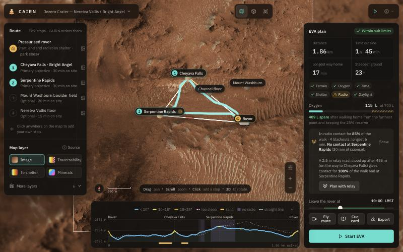
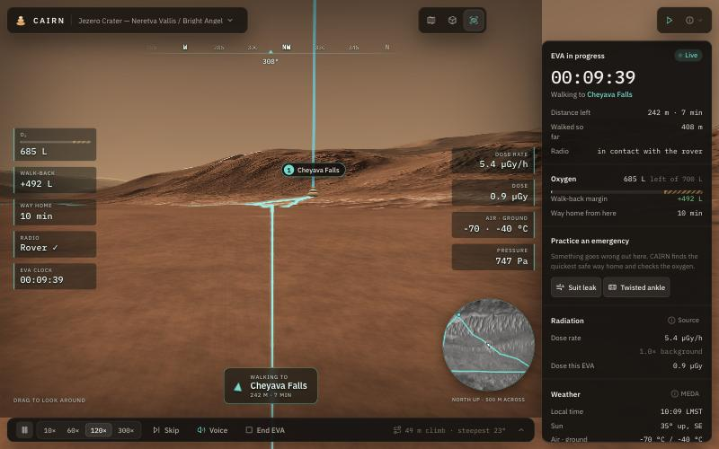
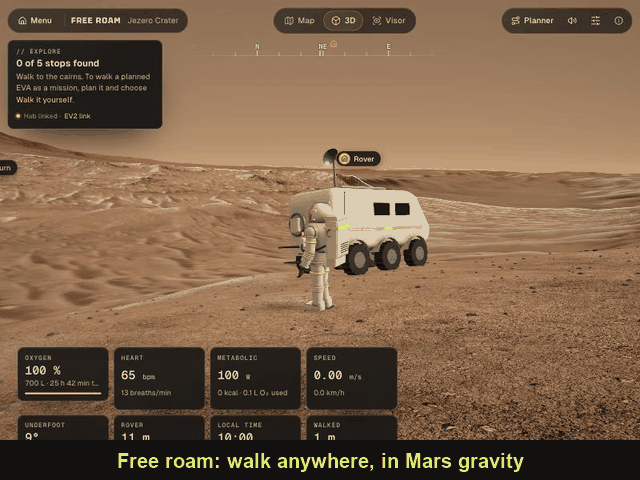
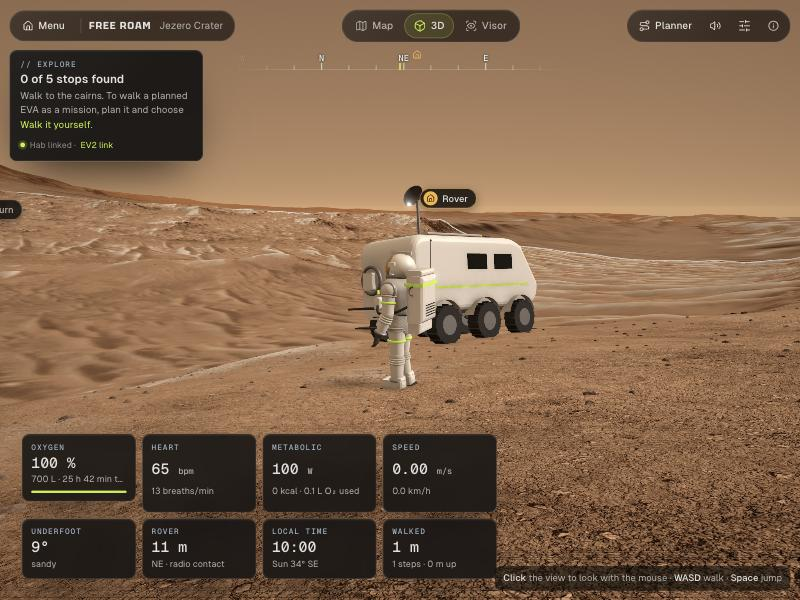
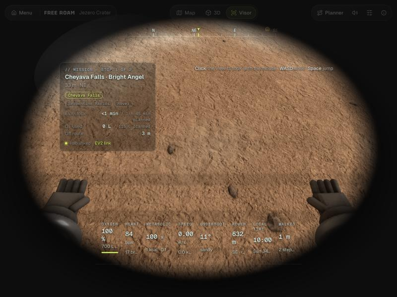
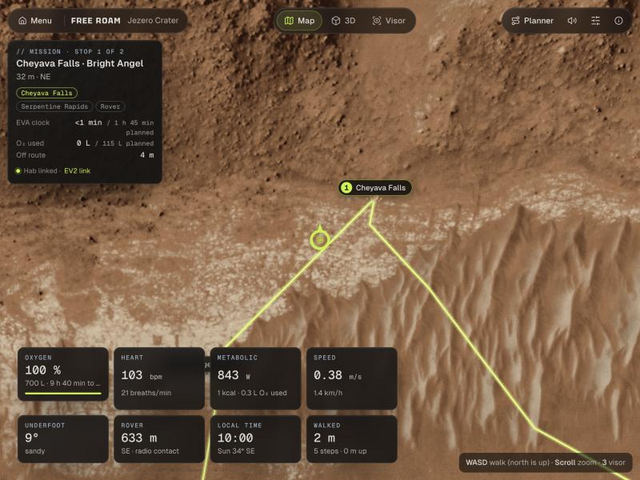
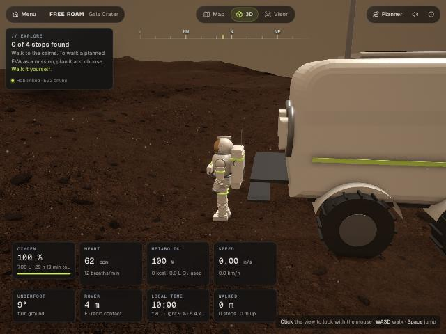

# CAIRN — Crew Assisted Integrated Route Navigator

> **The rocks Perseverance found. The path humans will walk.**

A Marswalk route planner for the first human explorers on Mars, built on official NASA, USGS and JPL data — at two real rover sites, **Jezero Crater** (Perseverance, Cheyava Falls) and **Gale Crater** (Curiosity, the Mount Sharp boxwork), and at a region proposed for the first human landing, **Deuteronilus Mensae**, where glaciers lie buried under rock debris.

Built for the **2026 NASA Space Apps Challenge** — *Interplanetary Survival Guide: Martian Map*.

<p>
  
  
</p>

<p>
  
</p>

**Live app: [cairn-mars.up.railway.app](https://cairn-mars.up.railway.app)** — Mission Control at
[cairn-mars.up.railway.app/?view=mission](https://cairn-mars.up.railway.app/?view=mission).

- [Introduction](docs/introduction.md) — the idea, the story and the vision
- [Project plan](docs/plan.md) — technical design and schedule
- [Data sources](docs/data-sources.md) — every dataset, with links and credits
- [Submission draft](docs/submission.md) — text for the Space Apps project page

---

## Try it in 60 seconds

1. **Open the EVA planner** from the briefing. The safe route to the objectives is already planned; the white line is the straight one, which crosses ground too steep to walk.
2. Read the **radio line** in the plan panel: hills cut the link, and one stop has no contact at all. Press **Plan with relay** — CAIRN has already found where the crew should stand up a relay mast.
3. Click the **Rover** row's *park closer* (or click the map → *Park rover*): the way home from every point is recomputed in under a second. **Ctrl/⌘ Z** undoes it.
4. Press **Start EVA**, then **Suit leak** or **Twisted ankle**: CAIRN finds the quickest safe way home and checks the oxygen. Or let the walk run into the real **20 May 2024 solar storm**.
5. Open the **Cue card**, or **Export** the route to Google Earth (Mars mode). Or just press **Demo**.

## What it does

Pick a site, pick the stops, and CAIRN plans the walk from the pressurised rover and back.

1. **Layers real mission data** on a 2 × 2 km walk area set in up to 16 km of surrounding terrain: HiRISE elevation (1 m) and imagery (25 cm), CRISM minerals, THEMIS night-time thermal, the USGS geologic map, loose sand, terrain sky-shielding and minutes to shelter.
2. **Finds the safest walking route** (walking energy × fall risk) between the stops you pick or any point you click, and shows it against the straight line — which crosses ground too steep to walk at both sites. You can also **park the pressurised rover** somewhere else (click the map → *Park rover*, or *park closer* to let CAIRN pick the flat spot nearest the chosen stops): the way home from every point and the radio coverage are recomputed in under a second (on Jezero, parking between the two stops halves the walk and gives radio contact the whole way).
3. **Budgets the EVA**: distance, time (with science time per stop adjustable in 5-minute steps), oxygen, walk-back margin and radiation dose, summed up in a row of safety checks (terrain, oxygen, time, shelter, radio, daylight) — with the **real Sun** for the chosen sol and start time, casting shadows from the real terrain. The start-time slider shows which departures keep daylight for the whole walk (and sunrise and sunset), the cue card marks stops that are in shade on arrival, and a click on *Longest way home* or *Steepest ground* flies to that point of the route.
4. **Shows what you will see**: rover photos taken at each stop, and **360° panoramas**: NASA's own colour panoramas at Bright Angel (Perseverance Mastcam-Z) and Nevado Sajama (Curiosity Mastcam), and at Gale's other stops panoramas CAIRN stitched from Curiosity's Navcam frames. Stops without photos (your own, placed on the map) get a HiRISE close-up from orbit.
5. **Walks the route** in a first-person visor view with compass, oxygen, dose, weather and a minimap, warning when radio drops or the Sun gets low. Afterwards an **EVA log** (also saved as Markdown) lists every arrival, radio loss and alert with mission and local time.
6. **Replays a real solar storm** (20 May 2024, measured by Curiosity's RAD). CAIRN finds the way back to the rover in milliseconds, names the nearest natural cover, and reports the dose avoided.
7. **Checks radio contact.** A line-of-sight model of the rover's antenna over the real terrain shows where hills cut the link, how much of the walk stays in contact, which stops have no contact at all (on Jezero's default walk: 30 min of science at Serpentine Rapids), and the best spot on the route for the crew to stand up a portable relay (85% → 100%, Serpentine Rapids included).
8. **Practises emergencies.** During a walk, *Suit leak* doubles oxygen use and *Twisted ankle* halves the walking speed; CAIRN finds the quickest safe way home from where the astronaut stands and checks the oxygen.
9. **Talks the crew through it.** Spoken directions in the visor: distance, turns, steep ground and sand ahead, arrivals, alerts, radio loss.
10. **Checks itself against the real rovers.** 68% of Perseverance's drive at Jezero (70% of Curiosity's at Gale) is on ground CAIRN rates easy or moderate, against 45% (41%) of the area: the rover drivers avoided what CAIRN avoids.
11. **Prints a one-page EVA cue card**: map with radio blackouts, timeline, turn-back oxygen per stop, storm protocol.
12. **Shares and exports the plan.** The plan lives in the link (stops, start time, options, relay, rover position), so it survives a reload, can be sent to a teammate, and every change can be undone (Ctrl/⌘ Z or Back); the route exports to KML (Google Earth in Mars mode) and GeoJSON (Mars 2000 coordinates).
13. **Works offline and installs as an app.** About → Use offline saves a whole site on the device — astronauts on Mars will not have the internet.
14. **Plays a two-minute guided demo** of the core story (Demo button or the briefing).

Colour-blind safe throughout: map layers and charts use the Okabe-Ito palette, and impassable ground is also hatched. Keyboard shortcuts (press `?`), screen-reader announcements for alerts, and reduced motion are supported; on phones the screen stays on during a walk and alerts vibrate.

Every layer, photo and reading names its mission, instrument and product in the **Data sources** panel and in [docs/data-sources.md](docs/data-sources.md).

## Free roam: walk it yourself

Plan an EVA, then walk it on foot — or just walk. *Free roam on foot* on the main menu, *Free roam* in the planner's top bar, *Walk it yourself* under *Start EVA*, or a **scenario**.

<p>
  
  
  
  
</p>

- **Physics, not animation**: Mars gravity, traction, a lope above 1.3 m/s, ballistic jumps, slides past the friction angle, falls that topple onto hands and knees and a 7 s suited get-up (details under *What it does*).
- **Missions**: the planned route and numbered stops; hold E to sample after picking the target from the **rover's own photos** at that stop; the clock runs on by the planned work time; climb back in through the suitport. The debrief scores oxygen, time, safe walking and (if the storm hit) sheltering in time, and lists the **decisions made alone**.
- **Earth one light time behind**: with the hab server, Mission Control watches the walk late, draws **Earth's best guess** of where you are now from the plan, and its messages reach your helmet only after the real delay (a revised plan can be accepted or declined).
- **Two astronauts**: open the same page with `&crew=ev2` on a second device; each sees the other's suit (EV1 fern stripes, EV2 amber), with no delay between them.
- **Field work on the way**: hold E anywhere for a field reading of the ground at your boots (CAIRN's sand and slope maps, the USGS geologic unit, how much sky the terrain blocks and, at Jezero, CRISM mineral strength). A task list gives each site its jobs with live hints: hunt for strong olivine, Fe/Mg clay and carbonate with a 40 m spectral signal; cross three geologic units; follow the real rover's route for 50 m; three soil tests 100 m apart; find the most sheltered 1 % of the ground for a storm; and stand up the relay mast (`R`) where it sees the rover, then talk through it from radio shadow. Finds plant a survey flag, go into Mission Control's log and the debrief. Readings and the mast cost work time and oxygen, like samples.
- **Harder walks**: the **20 May 2024 solar storm** mid-mission (30 minutes to get inside), **suit leak** or **twisted ankle** practice, and **dust storms** at measured optical depth.
- **Scenario presets**: a clear morning at Cheyava Falls, the 2024 storm, Gale in the 2018 global dust storm, two astronauts, a suit leak — each one tap to plan or to walk.
- **Settings**: rebind keys, reduce camera shake, captions for sound cues. Phones start on the light quality; slow laptops are offered it.

| Free roam | Keys (rebindable) |
|---|---|
| Walk · lope · jump | `W` `A` `S` `D` or arrows · `Shift` · `Space` (thumb stick and buttons on touch) |
| Sample / climb in / field reading · relay mast · gold visor | hold `E` · `R` · `G` |
| Views · sound · help · settings | `1` `2` `3` (`V` cycles) · `M` · `H` · `,` |

Address options: `?roam=1` free roam, `&crew=ev2` second astronaut, `&look=3d|visor|map`, `&dust=clear|regional|global|extreme` or `&tau=<n>`, `&emergency=leak@900` (or `ankle@<s>`), `&q=low|high`; a plan after `#` (`#stops=…&storm=0`) makes it a mission.

## Run it

Requires Node.js 24 or newer (the hab server runs its TypeScript directly). All data is already in the repository, so no downloads are needed.

```bash
cd web
npm install
npm run dev
```

Open the address Vite prints (normally http://localhost:5173).

| Command | What it does |
|---|---|
| `npm run dev:all` | Development: frontend and hab server together, one terminal (Ctrl+C stops both) |
| `npm run dev` | Development server (frontend only) |
| `npm test` | 126 unit and integration tests (including the hab server end to end) |
| `npm run build` | Type-check and build to `web/dist/` |
| `npm run preview` | Serve the built app |
| `npm start` | Build, then serve the app with the hab server (Mission Control, shared notebook) |
| `npm run hab` | The hab server alone, for development next to `npm run dev` |
| `npm run dev:https` | Same as `dev:all`, over https:// (phones and tablets need it to record voice notes) |
| `npm run start:https` | Same as `npm start`, over https:// |
| `npm run fetch-speech` | Once: put the speech-to-text model on the hab (about 45 MB, not committed) |

URL options: `?site=gale` opens Gale Crater's main menu (default `jezero`; the menu loads only its text and two images, and nothing of the planner until you open it), `?skip=1` opens the planner straight away, `?menu=1` the main menu even with a plan in the address, `?demo=1` plays the guided demo straight away (for a booth screen or recording the video), `?roam=1` opens free roam (add `&look=3d` to start behind the astronaut), `?q=low` uses a lighter mesh and the 50 cm texture for slow GPUs, `?tex=4k` stays on the 50 cm texture. The part after `#` is the plan, e.g. `#stops=cheyava,serpentine&t=9.5&relay=1`; links with a plan open straight on it.

Works on desktop, tablets and phones: below 1180 px the route and layers panel becomes a drawer (layers button, top right); in portrait the plan becomes a bottom sheet, and during a walk the controls sit in a strip above it.

Offline mode needs the built app (`npm run build`, then `npm run preview` or any static host): the service worker is not registered by the development server.

### With the hab server (Mission Control, shared notebook)

The planner works on its own, as a static site. Run it with the **hab server** — the habitat's computer — to link Mission Control on Earth and share the field notebook between devices:

```bash
cd web
npm start            # builds the app, then serves it with the hab on http://localhost:8787
```

The server prints its network address too (e.g. `http://192.168.1.10:8787`), so a second laptop, tablet or phone on the same Wi-Fi can join: one device walks the EVA, another runs Mission Control.

- **Mission Control** opens from the main menu (or the *Mission Control* button in the planner's top bar, or `?view=mission&site=jezero`). It shows the crew's position, oxygen, dose, log, notes and voice notes **one light time late** (13–22 min, for the EVA's real date), and messages typed there reach the crew one light time after they are sent. The delay runs on the EVA clock, so it speeds up with the simulation. While an EVA is under way on any site, every main menu shows a **Live EVA** card that opens that EVA's own Mission Control (or joins it as EV2), and a Mission Control opened for a quiet site points to the live one.
- **Field notebook** entries and voice notes are kept on the hab (`web/hab-data/`, not committed) and appear on every crew device; edits made offline sync when the hab is back. Finished EVAs are recorded there too.
- **Free roam.** *Free roam on foot* on the main menu (or *Free roam* in the planner's top bar) puts you in the suit at the rover's rear suitport, free to walk anywhere in the 2 × 2 km HiRISE area, seen on the map, from behind in 3D, or through the visor. The walking is physics, not animation: in 0.38 g your feet grip with 38 % of Earth's force, so you are slow to start, stop and turn; above 1.3 m/s a walk becomes a bounding lope (Froude number 0.5); jumps are ballistic (34 cm and 0.86 s in the air, against 13 cm on Earth); ground steeper than the friction angle makes you slide; hard landings can knock you down: the stiff pressurised suit topples like an inverted pendulum, 1.6× slower than on Earth, until the hands meet the real ground, settles onto the slope, slides on down if the ground is too steep to rest on, and only on steady ground gets up, taking about 7 s (sit back, one knee up, push to stand); every change of pose eases in, including breathing at rest, shuffling turns, kneeling to sample and reaching for the hatch; on steep ground you sit and slide feet first, braking with your hands. Oxygen, heart rate and breathing follow the planner's walking model. Boot prints stay in the regolith, coarse dust flies in clean arcs while the fine fraction hangs in the thin air, and you hear your breathing, footfalls and heartbeat through the suit. Suit and body numbers are labelled demo assumptions (Help in free roam lists them). WASD or a thumb stick, Shift to lope, Space to jump.
- **Walk your plan.** *Walk it yourself* in the planner (under *Start EVA*) turns the plan into a mission in free roam: the planned route is drawn on the ground and beacons mark the stops; walk to each in CAIRN's order, hold E to collect a sample (the clock runs on by the planned time on site, at the working metabolic rate, so the Sun moves), and climb back into the rover through its suitport. The debrief sets your time, oxygen, distance, falls and time off the route against the planner's figures for that exact route, with up to three stars. In the visor you are inside the helmet: the body turns with your view, your gloves show when you look down, the gold sun visor lowers with G, and you hear your own suit (fan, breathing, footsteps through the boots, heartbeat). In the 3D and map views you hear Mars from outside instead: wind and faint, dull footsteps, since its thin CO₂ air carries little sound.
- **Two astronauts, two devices.** Open the planner on one device (EV1) and choose *Join as EV2* on the main menu of another. EV1 plans and starts the EVA; EV2's device rebuilds the same plan and walks it in lockstep with EV1's EVA clock, from EV2's own position, each seeing the other suit. Notes taken by either appear on both. Mission Control labels EV1 and EV2 on its map.
- **Revised plans from Earth.** In Mission Control, *Propose a plan change*: click a stop to drop it or the map to add one, then send. It reaches the crew one light time later as a card to accept or decline (during an EVA, an accepted change applies back at the rover), and the crew's answer reaches Earth one light time after that.
- **Replay.** Every EVA recorded on the hab can be replayed in Mission Control: a timeline of Earth's clock, with what happened on Mars and when Earth found out.
- **Voice notes to text, on the device.** Run `npm run fetch-speech` once to put the speech model (Whisper tiny, ~45 MB) on the hab; then *Turn into text* in a note transcribes in a few seconds without the recording leaving the device.
- Without the hab, nothing changes: the planner shows a grey dot on *Mission Control* and keeps notes on the device.

**Phones and tablets need https:// to use the microphone** (browsers allow it only on https or localhost). `npm run dev:https` (or `npm run start:https`) makes a certificate for this computer's network address (`web/.cert/`, not committed) and serves over https. The certificate is self-signed, so each device warns once: choose *Advanced → Proceed* (Chrome) or *Show Details → visit this website* (Safari), and recording works from then on. If the computer's Wi-Fi address changes, a new certificate is made automatically.

For development, `npm run dev:all` starts both in one terminal (open http://localhost:5173; Ctrl+C stops both), or run `npm run hab` (restarts on changes) next to `npm run dev`; Vite forwards `/api` and `/hab` to it. Environment: `PORT` (8787), `HOST` (`0.0.0.0`), `CAIRN_DATA` (`web/hab-data`), `CAIRN_DIST` (`web/dist`).

### Deploy on Railway

The hab server serves the app, the API and the WebSocket from one process, so CAIRN runs as a single
Railway service. `railway.json` and `package.json` at the repository root hold the build and start
commands and the health check; they hand over to `web/`.

1. Create a project from this GitHub repository. Leave **Root Directory** empty (the repository
   root).
2. Add a **Volume** to the service, mounted at `/data`, and set the variable `CAIRN_DATA=/data`.
   Without it, notebooks, voice notes and EVA records are lost on every deploy.
3. Under **Networking**, generate a domain (the live app is at `cairn-mars.up.railway.app`). It is https, so the microphone works on phones, and
   Mission Control connects over `wss://` on the same address.

The build downloads the speech model (`npm run build:deploy` runs `fetch-speech`, then `build`).
Railway sets `PORT`; the server listens on `0.0.0.0`.

Keep the service at **one replica**: each site's room (light-time relay, Mission Control, EV2) lives
in the server's memory, so two replicas would split the crew from Earth. The built app is about
170 MB, of which 87 MB is site data, so most of the cost is outgoing traffic: a visitor opening one
site downloads tens of MB.

## Controls

| View | Mouse / trackpad | Keys |
|---|---|---|
| **Map** | Drag to move · scroll to zoom · double-click to fly there · click to add a stop | `+` `−` |
| **3D** | Drag to rotate and tilt · Shift-drag or right-drag to move · scroll to zoom · double-click to fly there (also outside the walk area) | Arrow keys rotate and tilt · `+` `−` · `N` faces north |
| **Visor** | Drag to look around | |
| **Any** | Hover the elevation chart to see that point on the map | `1` `2` `3` switch views · `Space` pauses the EVA · `Ctrl/⌘ Z` undoes a plan change (browser Back works too) · `Esc` closes · `?` lists shortcuts |

The buttons at the bottom-right of the map do the same things.

## The demo

Press **Demo** (top right) or **Watch the 2-minute demo** in the briefing. It walks through: the site → real terrain in 3D → traversability and the deadly straight line → the real Sun and shadows → radio contact and where to stand up a relay → a flyover → the walk, arriving at the first objective (with the 360° view at Gale) → the 20 May 2024 storm, where Earth's last "all quiet" arrives only after the alarm → the decisions the crew made alone → walking it yourself in free roam. Pause, skip or exit at any time.

## How it works

```
data-pipeline/  (Python)                     web/  (TypeScript + Three.js; static, or served by the hab)
  fetch_*.py     download official data        data/      loaders, terrain grid, path measurement
  build_site.py  terrain, slope, sand,         routing/   A*, return-to-shelter field, smoothing (Web Worker)
                 thermal, geology, textures    eva/       walking energy, oxygen budget, radiation
  build_region.py 16 km CTX surroundings
  build_rover.py stops, traverse, photos       replay/    EVA simulation and storm re-route
  build_replay.py RAD + DONKI storm replay     scene/     terrain mesh, layers, routes, cameras
  build_weather.py MEDA weather                ui/        briefing, panels, charts, dialogs
  build_context.py regional + global maps      app.ts     controller
                                               mission/   Mission Control dashboard
                                               hab/       link to the hab server (protocol, WebSocket, storage API)
                                             web/server/  the hab server (Node): static files, notebook storage,
                                                          live link with the light-time delay (room.ts)
        │
  pack_web.py    compress grids for the web
        │
        └──► web/public/data/<site>/   (Jezero 20 MB, Gale 28 MB with photos and panoramas; committed)
```

- **Sharp at every distance.** The 25 cm HiRISE image is sampled with Catmull-Rom filtering, lighting uses the full 1 m elevation gradient per pixel, and map layers are coloured on the GPU from the raw data grids, so they stay smooth instead of pixelated.
- **No edge of the world.** The walk area sits in 16 km of CTX terrain (20 m elevation, 6 m image). The two datasets differ by +0.3 m on average along the seam; that difference is blended out over 900 m and the images are tone-matched.
- **Real Sun, real shadows.** Mars24 (Allison & McEwen 2000) places the Sun for the chosen sol and local time — checked against rover clocks to within a minute. Each pixel marches toward the Sun across the elevation grids for cast shadows.
- **Terrain shielding.** For every grid point, CAIRN measures how much of the sky the surrounding terrain blocks, weighted toward the zenith where most of the dose comes from. Cliffs cut the dose by at most ~15–40% — the rover stays the real shelter, and the storm alert says so.
- **Stitched panoramas.** For every panorama pixel, the viewing ray is rotated into the rover frame (attitude quaternion) and projected through each Navcam frame's published CAHVOR camera model; frames are feathered and exposure-matched. Published only where the frames cover at least 85% of the horizon (four Gale stops; Sajama uses NASA's).
- **VR-ready 360° images.** Every panorama is a full-sphere equirectangular image at 8192 × 4096 (22.8 px per degree, the native resolution of the Navcam frames and of NASA's mosaics; nothing is upscaled), with Google Photo Sphere metadata so the files open as 360° photos in VR headsets and photo apps (`web/public/data/<site>/panoramas/*_8k.jpg`). The app shows a 4096 × 2048 copy first and streams the 8K one in where the GPU can hold it; offline mode keeps the 4K copies. What the cameras did not image (high sky, nadir, gaps) is filled smoothly and both poles blend to one tone so nothing pinches in a headset.
- **NASA panoramas, pointed north.** Photojournal mosaics (PIA26369, PIA26696) carry no pointing. CAIRN finds the skyline in the photo and matches it to the horizon computed from the HiRISE and regional elevation models at the rover's recorded position, fitting the azimuth, span, level and tilt while keeping the photo's proportions (median skyline difference 1.8° at Bright Angel, 0.5° at Sajama). Sky and ground beyond the mosaic's edges are filled and the viewer says so.
- **One renderer for 2D and 3D.** The map is the 3D terrain seen from straight above through a narrow lens, so routes and layers always line up and switching to 3D is a camera move.
- **Routing.** A\* over a 1025 × 1025 grid (2 m cells) minimises *walking energy × fall risk*. Energy uses the Minetti (2002) cost of walking on slopes with the real elevation of every step; loose sand and rough ground cost more; slopes above 25° are impassable.
- **The way home.** One Dijkstra pass from the rover stores the best route home from every grid point. The emergency re-route is then a lookup, and the same data draws the *Minutes to shelter* layer and the walk-back margin. Parking the rover elsewhere reruns that pass (and the rover's radio shadow) in the routing worker in about 0.4 s; *park closer* starts from the geometric median of the stops.
- **Undo for free.** The plan is the URL hash and every edit is a browser history entry, so Back / Ctrl+Z restore the previous plan exactly and a copied link reproduces it.
- **One measuring function.** `measurePath()` produces every number shown about a route, so the router, the budget, the chart and the simulation cannot disagree.
- **Radio line of sight.** Rays from the rover's mast antenna (3 m) to every edge of the grid keep the steepest terrain angle seen so far, with the curvature of Mars; each point stores how far a suit antenna (1.8 m) would have to rise to see the rover. The relay search tries every ~8 m of the route where a 2.5 m mast still sees the rover and counts the blackout time it covers *after* the crew gets there.
- **Fast first load.** Grids are row-delta coded and gzipped (Gale: 6.3 → 3.2 MB), the HiRISE images and relief map are WebP (the 25 cm image: 14.5 → 8 MB), and all files load in parallel with the return-to-shelter calculation. The planner opens on the 50 cm image; the 25 cm one streams in afterwards.
- **Mars–Earth delay on one timeline.** The hab server holds every item that crosses between Mars and Earth until the EVA clock has moved on by one light time (from JPL planet positions for the EVA's date), in both directions; a Mission Control screen that joins late gets exactly what Earth could know by then. Unit-tested on the delay logic and end to end over real WebSockets.
- **Offline.** A service worker keeps the app and every file of a site; its data cache is versioned by the data, so app updates do not throw away a saved site.

## Rebuilding the data

Only needed to change the site or the processing. Requires Python 3.11+.

```bash
cd data-pipeline
make setup     # virtual environment + dependencies
make fetch     # downloads from USGS, NASA PDS, mars.nasa.gov, DONKI, Mars Trek (several GB of range requests; resumable)
make build     # writes web/public/data/jezero/  (make gale, make deuteronilus for the others; all end with pack_web.py)
```

`python progress.py --watch` shows download progress. DONKI uses `DEMO_KEY` unless `NASA_API_KEY` is set.

Dust by sol: put the two optical-depth records in `data-pipeline/raw/dust/` (Curiosity: `msl_tau_880.csv` from the NASA PDS bundle `msl_mmm_tau_bundle`; Perseverance: `m20-ztau-merged-1499.txt` from Mendeley Data, DOI 10.17632/gktjp9jptb.1), then `python build_dust.py` writes `dust.json` for every site.

## What is real and what is assumed

| Real mission data | Assumptions and derived products |
|---|---|
| CRISM mineral band depths (Jezero; 25% of the walk area imaged) | Mineral strengths scaled to the observations; terrain-shielding zenith exponent |
| Rover Navcam frames and camera models | The stitched panoramas (filled sky and ground under the rover are marked as filled) |
| Poly Haven CC0 photo-scanned materials (Red Sand, Dry Ground Rocks, Cracked Red Ground, Rock Boulder Dry) | Close-up ground and rock texture in the 3D view only (rendering detail; colour stays HiRISE) |
| NASA/JPL-Caltech Photojournal PIA26369, PIA26696 | 360° colour panoramas at Bright Angel and Nevado Sajama |
| Terrain, imagery, thermal image, geologic units | Spacesuit and physiology numbers (mass, oxygen supply, speeds) — demo values, listed in *Model assumptions* |
| Stop positions and Perseverance's traverse | Loose-sand hazard — our own analysis of HiRISE and THEMIS data |
| Photos at each stop | Mars colour in the 3D view — a display tint; HiRISE is a grey image |
| Weather (Perseverance MEDA, sol 1215) | Rover shielding factor (0.5) |
| Radiation background and storm readings (Curiosity RAD) | The first ~13 hours of the storm's dose-rate curve (see below) |
| The eruption record and alert (NASA DONKI) | Antenna heights (rover mast 3 m, suit 1.8 m, relay mast 2.5 m) and line-of-sight radio with no reflections |
| Perseverance and Curiosity drive paths (rover check) | Practice emergencies: suit leak doubles oxygen use, twisted ankle halves the speed |
| Sun position for the EVA sol (Mars24) | Thresholds: low sun under 8°, shade judged at 1.2 m, shelter within 30 min, rover parks on ≤ 10° ground (its drive is not modelled) |

**The storm replay.** Curiosity's archived RAD data holds 2–4 hours of dosimetry per sol, so the start of the 20 May 2024 storm is not recorded. CAIRN shows the real readings as dots (background 5.4 µGy/h before the storm, 34.7 µGy/h at 19:08 UTC on 20 May) and fills the gap with a model: the tail is fitted to those readings and the peak is scaled so the total equals the 8,100 micrograys NASA reported. The chart labels measured and modelled values separately. Curiosity is in Gale crater, about 3,700 km from Jezero.

## Sites

| | Jezero Crater | Gale Crater | Deuteronilus Mensae |
|---|---|---|---|
| Rover | Perseverance | Curiosity | None — in Deuteronilus Mensae, about 170 km west of the nearer of two Exploration Zones proposed at NASA's 2015 workshop |
| Objectives | Cheyava Falls (potential biosignature), Serpentine Rapids | Boxwork ridge (main exposure), Nevado Sajama drill site | Edge of a debris-covered glacier, brain terrain on the apron |
| Terrain | USGS Mars 2020 TRN HiRISE mosaics + 16 km CTX surroundings | HiRISE DTM DTEEC_019698_1750_019988_1750 + 6.8 km of the same strip | HiRISE DTM DTEEC_033653_2225_033363_2225 ('Ice-rich lobate debris apron') + the same strip around it |
| Weather | MEDA, sol 1215 | REMS, sol 4605 | — (no instrument has measured it) |
| Extra layers | THEMIS, USGS geology, CRISM minerals | THEMIS night thermal (global mosaic via Mars Trek) | NASA's 2015 Exploration Zones on the locator map |
| Stop images | Rover photos; NASA Mastcam-Z 360° at the Bright Angel viewpoint | Rover photos, 360° panoramas at all five stops (NASA Mastcam at Sajama) | HiRISE close-ups from orbit |
| Storm | Curiosity RAD, 3,700 km away | Curiosity RAD, 2.3 km away | Curiosity RAD, 6,800 km away (example) |

## Differences from the plan

- **Second target.** Three Forks is 6.7 km from Cheyava Falls — a rover drive, shown on the regional map. The second walking objective is Serpentine Rapids.
- **THEMIS is displayed and used for sand detection**, not as a routing cost on its own: at ~100 m per pixel it is too coarse for a walking route.
- **Regional map** uses the USGS CTX mosaic bundled with the app; Mars Trek tiles supply the global locator.
- **After the storm** the EVA ends at the rover and the remaining stops are re-planned for a later sol, because RAD measured elevated dose rates for about two sols.

## Credits

Data: NASA/JPL-Caltech, University of Arizona, Arizona State University, MSSS, USGS Astrogeology, NASA PDS, NASA CCMC. Full list in [docs/data-sources.md](docs/data-sources.md).

Methods: Minetti et al. (2002), *J. Appl. Physiol.* 93:1039 (energy cost of walking on slopes); Tobler (1993) hiking function; Lejeune et al. (1998), *J. Exp. Biol.* 201:2071 (walking on sand).

This project is not affiliated with or endorsed by NASA.
