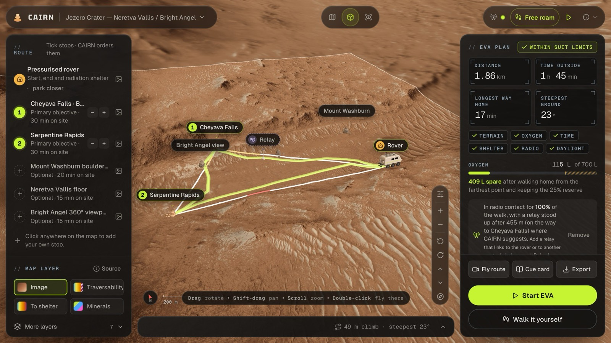
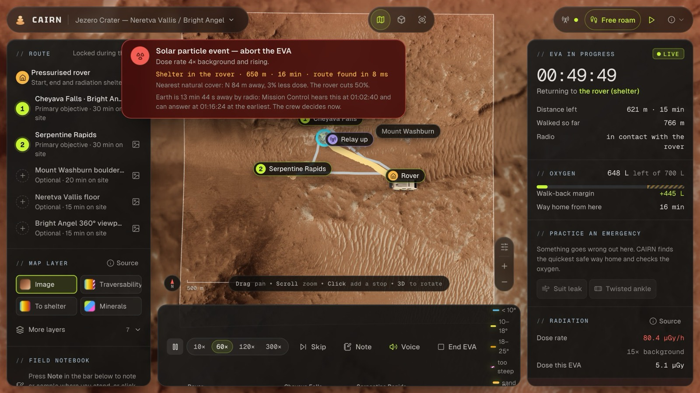
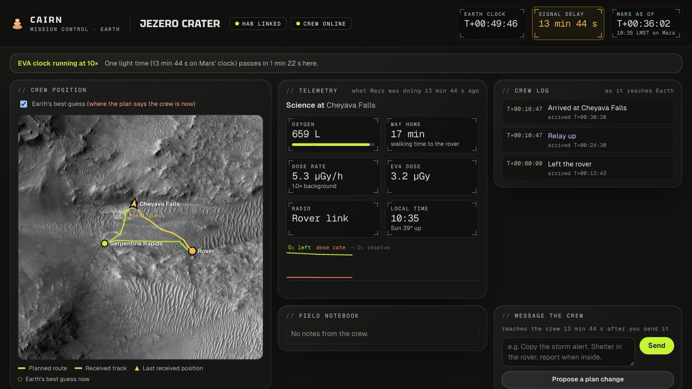
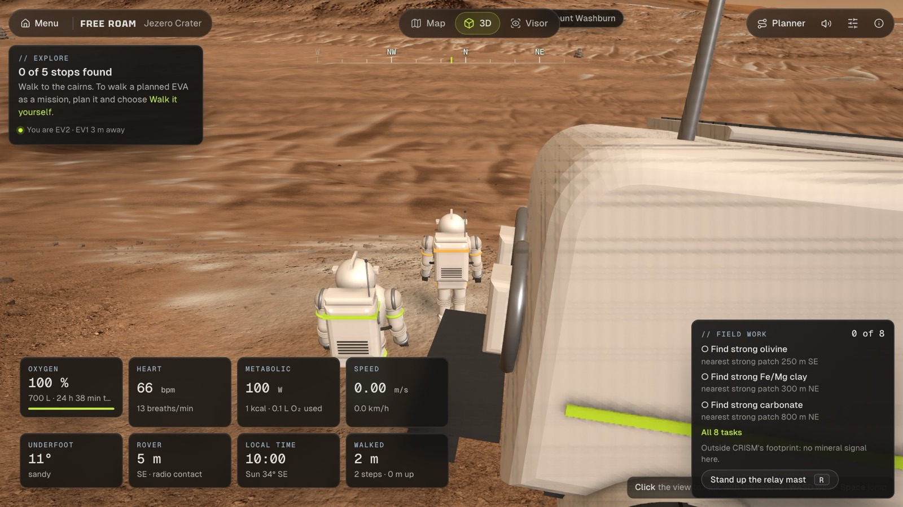
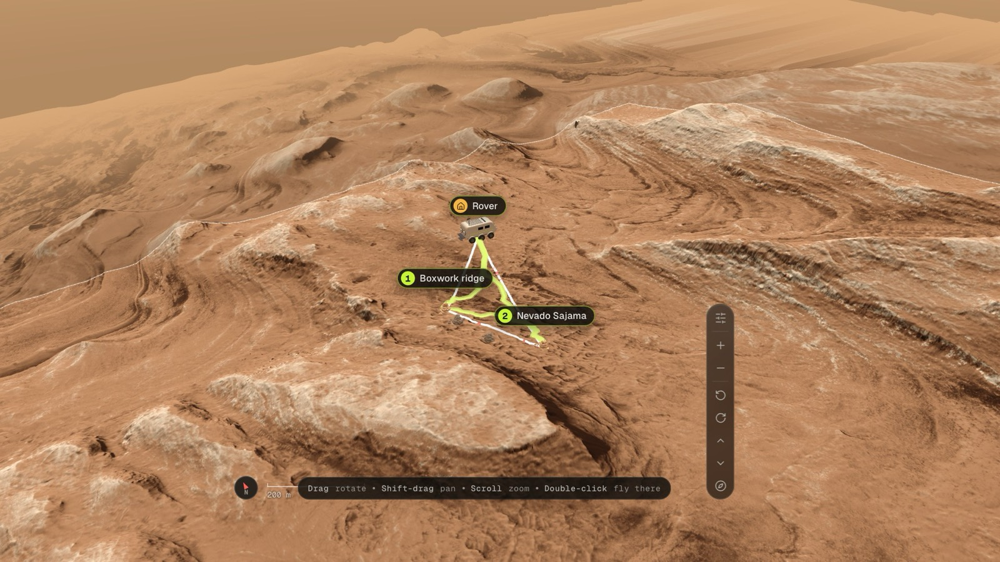
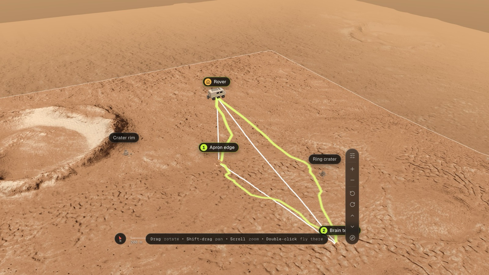

<div align="center">


# CAIRN

**Crew Assisted Integrated Route Navigator**

*The rocks Perseverance found. The path humans will walk.*

[**Open the live app**](https://cairn-mars.up.railway.app) · [Mission Control](https://cairn-mars.up.railway.app/?view=mission) · [Introduction](docs/introduction.md) · [Data sources](docs/data-sources.md)

NASA Space Apps Challenge 2026 · *Interplanetary Survival Guide: Martian Map*

</div>

<br>


<br>

> On Mars, a radio message takes **3 to 22 minutes** to reach Earth, and as long again to come back.
> When something goes wrong outside, the crew decides alone.
> **CAIRN** plans a walk on Mars so that every one of those decisions has an answer before anyone leaves the rover.

CAIRN is a route planner and simulator for the first people to walk on Mars. It is built on official NASA, USGS and JPL data at three real places:

| | Site | Why it matters |
|---|---|---|
| 🟢 | **Jezero Crater** | Perseverance's *Cheyava Falls*, the "leopard spots" NASA calls a potential biosignature |
| 🟢 | **Gale Crater** | Curiosity's Mount Sharp boxwork and the Nevado Sajama drill site |
| 🔵 | **Deuteronilus Mensae** | A glacier buried under rock debris (water), about 174 km from the nearest Exploration Zone proposed at NASA's 2015 human-landing workshop |

---

## ✦ What it does

<table>
<tr>
<td width="50%" valign="top">

### Plan the walk
Pick the stops and CAIRN finds the **safest route**, not the shortest, over 1 m HiRISE terrain. It budgets **oxygen, time and dose**, and checks the **walk-back margin** from the farthest point. It also keeps a **shelter within 30 minutes**, keeps **radio contact**, and keeps the walk in **daylight** under the real Sun.

</td>
<td width="50%" valign="top">



</td>
</tr>
<tr>
<td valign="top">



</td>
<td valign="top">

### Survive a real storm
Replay the **20 May 2024 solar particle event**, measured by Curiosity's RAD. The alarm sounds, CAIRN routes the crew back to the rover in milliseconds and reports the dose they avoided. You can also practise a **suit leak** or a **twisted ankle**.

</td>
</tr>
<tr>
<td valign="top">

### Talk to Earth, late
**Mission Control** sees everything **one light time late**, draws *Earth's best guess* of where the crew is now, and can send messages or a revised plan. After each walk, the **autonomy debrief** lists every decision the crew had to make alone.

</td>
<td valign="top">



</td>
</tr>
<tr>
<td valign="top">



</td>
<td valign="top">

### Walk it yourself
**Free roam** puts you in the suit with real **Mars-gravity physics**: lope, jump, slide and fall. Oxygen, heart rate and breathing follow your effort. Walk your plan as a mission, do field work, and bring a second astronaut (**EV2**) on another device.

</td>
</tr>
</table>

### Everything else

| | |
|---|---|
| 📡 **Radio and relays** | A line-of-sight model shows where hills cut the link. Stand up relay masts that hop from mast to mast around ridges. |
| 🗺️ **Map layers** | Traversability, minutes to shelter, CRISM minerals, USGS geology, THEMIS thermal, slope, hab-site suitability |
| 🌄 **See the place** | Rover photos at each stop, and 8K 360° panoramas from NASA's mosaics or stitched from Navcam frames |
| 🗣️ **Voice guidance** | A free neural voice (Kokoro) that speaks only when something changes. Mission Control's messages use a voice channel of their own. |
| 📓 **Field notebook** | Geotagged notes and voice notes, turned into text on the device, shared through the hab |
| 👥 **Crew sessions** | Every EV1 opens a session listed on the main menu; anyone can join as EV2 or watch as Mission Control |
| 🌪️ **Dust storms** | Measured optical depth by sol, from a clear morning to the 2018 global storm |
| 🧾 **Exports** | A one-page cue card, KML for Google Earth (Mars mode), GeoJSON, the plan as a link, the EVA log |
| 📴 **Offline** | Installs as an app and saves a whole site on the device |
| ♿ **Accessible** | Colour-blind-safe palette, keyboard shortcuts, screen-reader alerts, reduced motion, phones and tablets |

---

## ▶ Try it in 60 seconds

1. **Open the EVA planner.** The safe route is already planned. The white line is the straight one, and it crosses ground too steep to walk.
2. Read the **radio line** and press **Plan with relay**. CAIRN has already found where to stand up a mast.
3. Press **Start EVA** and let it run into the **20 May 2024 storm**, or try **Suit leak**.
4. Open **Mission Control** in a second tab and watch Earth fall behind.
5. Press **Walk it yourself** to do it on foot. Or just press **Demo** for the two-minute guided tour.

---

## ⚙ Run it

Requires **Node.js 24+**. All site data is already in the repository.

```bash
cd web
npm install
npm run dev:all      # app on http://localhost:5173 + hab server (Mission Control, EV2, notebook)
```

| Command | What it does |
|---|---|
| `npm run dev:all` | App and hab server together in one terminal (Ctrl+C stops both) |
| `npm run dev` | App only: the planner works on its own, without Mission Control |
| `npm start` | Build, then serve everything from the hab on http://localhost:8787 |
| `npm run dev:https` / `start:https` | The same over https:// (phones need it for the microphone) |
| `npm test` | 135 unit and integration tests, including the hab server end to end |
| `npm run build` | Type-check and build to `web/dist/` |
| `npm run render-voice` | Re-render the voice clips after changing spoken phrases or stop names |
| `npm run fetch-speech` | Once: put the speech-to-text model on the hab (~45 MB) |

<details>
<summary><b>Address options</b></summary>

<br>

| Option | Effect |
|---|---|
| `?site=jezero\|gale\|deuteronilus` | Choose the site (the main menu loads only its text and two images) |
| `?skip=1` · `?menu=1` · `?demo=1` | Open the planner straight away · the main menu even with a plan · the guided demo |
| `?view=mission` | Mission Control |
| `?roam=1` | Free roam. Add `&look=3d\|visor\|map`, `&crew=ev2`, `&dust=clear\|regional\|global\|extreme` or `&tau=<n>`, `&emergency=leak@900` (or `ankle@<s>`) |
| `&delay=real` · `&delay=<s>` | Free roam's link to Mission Control (10 s by default, so Earth's messages arrive while you walk) |
| `&s=<session>` | A crew session (links and reloads keep it) |
| `?q=low` · `?tex=4k` · `?tex=8k` | Lighter mesh and image for slow GPUs · stay on the 50 cm image · force the 25 cm one (phones skip it) |
| `#stops=cheyava,serpentine&t=9.5&relay=1` | The plan itself: stops, start time, options, relays (`relay=x_y,x_y`), rover position |

</details>

<details>
<summary><b>Controls</b></summary>

<br>

| View | Mouse / trackpad | Keys |
|---|---|---|
| **Map** | Drag to move · scroll to zoom · double-click to fly there · click for the map menu (stop, note, relay, park rover) | `+` `−` |
| **3D** | Drag to rotate · Shift- or right-drag to move · scroll to zoom · double-click to fly there | Arrows rotate and tilt · `N` faces north |
| **Visor** | Drag to look around | |
| **Any** | Hover the elevation chart to find that point | `1` `2` `3` views · `Space` pauses · `Ctrl/⌘ Z` undoes · `Esc` · `?` lists shortcuts |
| **Free roam** | Drag or pointer lock to look | `WASD`/arrows walk · `Shift` lope · `Space` jump · hold `E` sample, read, climb in · `R` relay mast · `G` gold visor · `1` `2` `3` views · `M` sound · `H` help · `,` settings (all rebindable; thumb stick on touch) |

</details>

---

## 🔭 In depth

<details>
<summary><b>The planner, feature by feature</b></summary>

<br>

1. **Layers real mission data** on a 2 × 2 km walk area set in up to 16 km of surrounding terrain: HiRISE elevation (1 m) and imagery (25 cm), CRISM minerals, THEMIS night-time thermal, the USGS geologic map, loose sand, terrain sky-shielding and minutes to shelter.
2. **Finds the safest walking route** (walking energy × fall risk) between the stops you pick or any point you click, and shows it against the straight line. **Park the rover** elsewhere (map → *Park rover*, or *park closer*), and the way home from every point and the radio coverage are recomputed in under a second.
3. **Budgets the EVA**: distance, time (science time per stop in 5-minute steps), oxygen, walk-back margin and dose. The results sit in a row of safety checks: terrain, oxygen, time, shelter, radio and daylight. The **real Sun** for the chosen sol casts shadows from the real terrain. The start-time slider shows which departures keep daylight for the whole walk.
4. **Shows what you will see**: rover photos at each stop and **360° panoramas**. These are NASA's own at Bright Angel (Mastcam-Z) and Nevado Sajama (Mastcam), plus panoramas CAIRN stitched from Curiosity's Navcam frames. Your own stops get a HiRISE close-up.
5. **Walks the route** in a first-person visor with compass, oxygen, dose, weather and a minimap. An **EVA log** (also saved as Markdown) records every arrival, radio loss and alert.
6. **Replays the 20 May 2024 solar storm**. It finds the way back in milliseconds, names the nearest natural cover and reports the dose avoided.
7. **Checks radio contact** from the rover's antenna over the real terrain, and suggests the best relay spot (85% → 100% contact on Jezero's walk). Or **place masts yourself**, as many as needed. Each must stand within 60 m of the route and see the rover *or another mast*. A mast helps only once every mast between it and the rover is up.
8. **Practises emergencies**: a *suit leak* doubles oxygen use and a *twisted ankle* halves the speed. CAIRN finds the quickest way home and checks the oxygen.
9. **Talks the crew through it** only when something changes: a real turn, steep ground or sand, 100 m to go, arrivals, alerts.
10. **Checks itself against the real rovers**: 68% of Perseverance's drive (70% of Curiosity's) is on ground CAIRN rates easy or moderate, against 45% (41%) of the area.
11. **Prints a one-page cue card** with the map, radio blackouts, the timeline, the turn-back oxygen per stop and the storm protocol.
12. **Lives in the link**: the plan survives a reload, can be sent to a teammate, and every change can be undone (Ctrl/⌘ Z or Back).
13. **Works offline** (About → Use offline) and plays a **two-minute guided demo**.

Every layer, photo and reading names its mission, instrument and product in **About → Data sources** and in [docs/data-sources.md](docs/data-sources.md).

</details>

<details>
<summary><b>Free roam: the physics, missions and field work</b></summary>

<br>

<p>
  
  
</p>

- **Physics, not animation.** In 0.38 g your boots grip with 38% of Earth's force, so you are slow to start, stop and turn. Above 1.3 m/s a walk becomes a bounding lope (Froude 0.5). Jumps are ballistic: 34 cm and 0.86 s in the air. Ground steeper than the friction angle makes you slide. A hard landing topples the stiff suit like an inverted pendulum, and the suited get-up takes about 7 s. Oxygen, heart rate and breathing follow the planner's walking model.
- **Missions.** *Walk it yourself* draws the plan on the ground. Hold E at each stop to sample, after picking the target from the rover's own photos, and climb back in through the suitport. The debrief scores oxygen, time, safe walking and sheltering, with up to three stars.
- **Field work.** Hold E anywhere for a reading of the ground at your boots. Each site has a task list: hunt for strong olivine, Fe/Mg clay and carbonate, cross three geologic units, follow the real rover's route, run soil tests, find the most sheltered ground, and stand up the relay mast (`R`).
- **Earth on a 10 s link.** Free roam runs in real time, so Mission Control's link is shortened to 10 s and its messages pop up in your helmet while you walk. The HUD says it is shortened (from 17 min 04 s on the Gale date), and `&delay=real` keeps the true light time.
- **Two astronauts.** When either one goes out on foot, the other follows into free roam with the same plan. EV1 wears fern stripes and EV2 amber, with no delay between them. If EV1 leaves, EV2 is told and can go back to the main menu.
- **Sound.** Inside the helmet you hear your fan, breathing, footsteps through the boots and heartbeat. Outside you hear only faint wind and dull footsteps, because thin CO₂ air carries little sound.
- **Harder walks**: the 2024 storm mid-mission, suit emergencies, dust at measured optical depth, and **scenario presets** that set each one up in a tap.

Suit and body numbers are labelled demo assumptions (Help in free roam lists them).

</details>

<details>
<summary><b>The hab server: Mission Control, EV2, crew sessions</b></summary>

<br>

The planner works on its own as a static site. With the **hab server** (the habitat's computer, `npm start`), devices on the same network join one crew: one device walks the EVA, another runs Mission Control.

- **Mission Control** shows the crew's position, oxygen, dose, log, notes and voice notes **one light time late** (13–22 min for the EVA's date, on the EVA clock, so it speeds up with the simulation). Messages reach the crew one light time after sending. *Propose a plan change* sends a revised plan that the crew can accept or decline. Every recorded EVA can be **replayed**.
- **Crew sessions.** Every EV1 on any site opens a session. The main menu lists them all with their route, each with *Join as EV2* and *Mission Control*. An empty session closes 2 minutes after everyone leaves, or after 1 hour if an EVA was still running.
- **EV2** rebuilds EV1's plan and walks it in lockstep with EV1's EVA clock, from its own position. Notes taken by either appear on both.
- **Field notebook** entries are kept on the hab (`web/hab-data/`) and sync when the hab is back. **Voice notes to text** run on the device (Whisper tiny, after `npm run fetch-speech`).
- Phones and tablets need **https://** for the microphone: `npm run dev:https` makes a local certificate (accept the warning once per device).
- Environment: `PORT` (8787), `HOST` (`0.0.0.0`), `CAIRN_DATA` (`web/hab-data`), `CAIRN_DIST` (`web/dist`).

</details>

<details>
<summary><b>Deploy on Railway</b></summary>

<br>

The hab server serves the app, the API and the WebSocket from one process, so CAIRN runs as a single Railway service. `railway.json` and `package.json` at the repository root hand over to `web/`.

1. Create a project from this repository and leave **Root Directory** empty.
2. Add a **Volume** mounted at `/data` and set `CAIRN_DATA=/data`. Without it, notebooks and EVA records are lost on every deploy.
3. Under **Networking**, generate a domain. It is https, so the microphone works on phones and Mission Control connects over `wss://`.

Keep **one replica**: each crew session's room lives in the server's memory. The build is about 170 MB, 87 MB of it site data.

</details>

<details>
<summary><b>How it works</b></summary>

<br>

```
data-pipeline/  (Python)                     web/  (TypeScript + Three.js)
  fetch_*.py      download official data       routing/   A*, return-to-shelter field (Web Worker)
  build_site.py   terrain, slope, sand,        eva/       walking energy, oxygen, radiation, radio, sky
                  thermal, geology, textures   replay/    EVA simulation and storm re-route
  build_region.py 16 km CTX surroundings       scene/     terrain mesh, layers, routes, cameras
  build_rover.py  stops, traverse, photos      roam/      free roam: physics, avatar, missions, field work
  build_replay.py RAD + DONKI storm replay     mission/   Mission Control
  pack_web.py     compress for the web         hab/       link to the hab server
        │                                    web/server/  the hab: static files, storage, light-time relay
        └──► web/public/data/<site>/
```

- **Routing.** A\* over a 1025 × 1025 grid (2 m cells) minimises *walking energy × fall risk*, using the Minetti (2002) cost of walking on slopes. Sand and rough ground cost more, and slopes above 25° are impassable.
- **The way home.** One Dijkstra pass from the rover stores the best route home from every point. That makes the emergency re-route a lookup, and it also draws the *Minutes to shelter* layer.
- **One measuring function.** `measurePath()` produces every number shown about a route, so the router, budget, chart and simulation cannot disagree.
- **Real Sun, real shadows.** Mars24 places the Sun for the sol and time, and each pixel marches toward it across the elevation grid.
- **Radio line of sight.** Rays from the rover's 3 m antenna keep the steepest terrain angle with the curvature of Mars. Relay masts link mast to mast.
- **Mars–Earth delay on one timeline.** The hab holds everything crossing between Mars and Earth until the EVA clock has moved on by one light time (from JPL planet positions for the EVA's date). This is unit-tested and tested end to end over WebSockets.
- **Sharp and fast.** The 25 cm image uses Catmull-Rom filtering with per-pixel 1 m lighting. Grids are delta-coded and gzipped, and the 25 cm image streams in after the 50 cm one.
- **Panoramas.** Navcam frames are stitched through their CAHVOR camera models. NASA mosaics are pointed north by matching their skyline to the HiRISE horizon. All of them are 8192 × 4096 with Photo Sphere metadata, ready for VR.
- **Undo for free.** The plan is the URL hash, so Back and Ctrl+Z restore it exactly.

</details>

<details>
<summary><b>What is real and what is assumed</b></summary>

<br>

| Real mission data | Assumptions and derived products |
|---|---|
| HiRISE terrain and imagery, THEMIS, USGS geologic units | Spacesuit and physiology numbers (demo values, listed in *Model assumptions*) |
| CRISM mineral band depths (Jezero, 25% of the area imaged) | Mineral strengths scaled to the observations |
| Rover photos, Navcam frames and camera models | The stitched panoramas (filled areas are marked) |
| NASA Photojournal PIA26369, PIA26696 | Loose-sand hazard (our analysis of HiRISE and THEMIS) |
| Perseverance and Curiosity traverses | Mars colour in 3D (HiRISE is a grey image) |
| Weather: MEDA (sol 1215), REMS (sol 4605) | Rover shielding factor 0.5; terrain-shielding zenith exponent |
| Curiosity RAD readings and NASA DONKI | The first ~13 h of the storm's dose-rate curve (below) |
| Sun position (Mars24), light time (JPL elements) | Antenna heights, line-of-sight radio, free roam's 10 s link |
| Poly Haven CC0 ground scans (close-up detail only) | Thresholds: low sun < 8°, shelter ≤ 30 min, rover parks on ≤ 10° |

**The storm replay.** Curiosity's archived RAD data holds only 2–4 hours per sol, so the start of the 20 May 2024 storm was not recorded. CAIRN shows the real readings as dots and fills the gap with a model: the tail is fitted to the readings and the peak is scaled so the total equals the **8,100 µGy** NASA reported. The chart labels measured and modelled values separately.

</details>

<details>
<summary><b>The three sites</b></summary>

<br>

<p>
  
  
</p>

| | Jezero Crater | Gale Crater | Deuteronilus Mensae |
|---|---|---|---|
| Rover | Perseverance | Curiosity | None. About 174 km from the nearest 2015 Exploration Zone |
| Objectives | Cheyava Falls, Serpentine Rapids | Boxwork ridge, Nevado Sajama | Glacier edge, brain terrain on the apron |
| Terrain | USGS Mars 2020 TRN HiRISE + 16 km CTX | HiRISE DTEEC_019698_1750_019988_1750 | HiRISE DTEEC_033653_2225_033363_2225 |
| Weather | MEDA, sol 1215 | REMS, sol 4605 | No instrument has measured it |
| Extra layers | THEMIS, USGS geology, CRISM minerals | THEMIS night thermal | Exploration Zones on the locator |
| Stop images | Rover photos, Mastcam-Z 360° | Rover photos, 360° at all five stops | HiRISE close-ups |
| Storm data | Curiosity RAD, 3,700 km away | Curiosity RAD, 2.3 km away | Curiosity RAD, 6,800 km away (example) |

</details>

<details>
<summary><b>Rebuilding the data</b></summary>

<br>

Only needed to change a site or the processing. Requires Python 3.11+.

```bash
cd data-pipeline
make setup     # virtual environment + dependencies
make fetch     # official downloads (several GB, resumable)
make build     # web/public/data/jezero/  (make gale, make deuteronilus)
```

`python progress.py --watch` shows download progress. DONKI uses `DEMO_KEY` unless `NASA_API_KEY` is set. For the dust records, see `build_dust.py`.

</details>

---

<div align="center">

**Data**: NASA/JPL-Caltech, University of Arizona, Arizona State University, MSSS, USGS Astrogeology, NASA PDS, NASA CCMC ([full list](docs/data-sources.md))<br>
**Methods**: Minetti et al. (2002) · Tobler (1993) · Lejeune et al. (1998) · Allison & McEwen (2000)

[Introduction](docs/introduction.md) · [Project plan](docs/plan.md) · [Data sources](docs/data-sources.md) · [Submission](docs/submission.md) · [For developers (AGENTS.md)](AGENTS.md)

<sub>Not affiliated with or endorsed by NASA.</sub>

</div>
